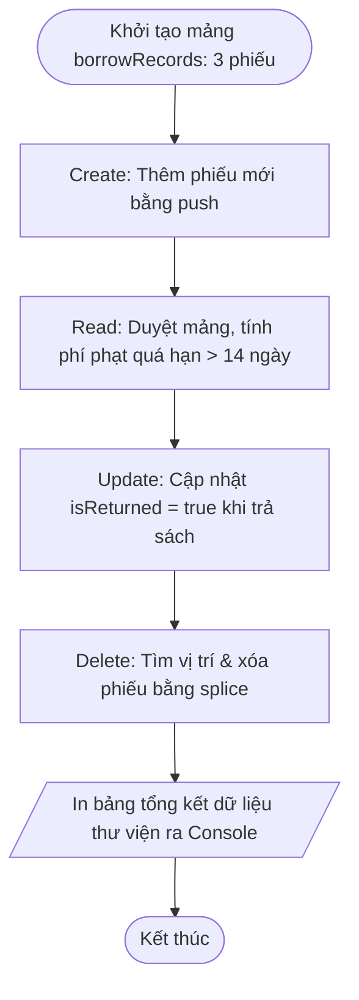

# BÁO CÁO BÀI TẬP: QUẢN TRỊ DANH SÁCH PHIẾU MƯỢN SÁCH THƯ VIỆN TRÊN CẤU TRÚC MẢNG ĐỐI TƯỢNG

> 👤 **Học viên:** Hoàng Công Dũng | **Mã SV:** PTIT-HCM-009
> 🏫 **Môn học:** it103b-rl-HoangCongDung

---

## 📊 Sơ đồ thiết kế hệ thống (Flowchart)

> 💡 *Sơ đồ dưới đây được render tự động trực tiếp trên GitHub bằng Mermaid. Bạn cũng có thể tải file **`bt3.drawio`** trong repository này để mở và chỉnh sửa trực tiếp trên [Draw.io (diagrams.net)](https://app.diagrams.net).* 

---

## 1. Mục tiêu và Bối cảnh bài toán

Bài tập này giúp em nắm vững chuỗi thao tác CRUD trên mảng các đối tượng (Array of Objects) trong Javascript, áp dụng trực tiếp vào bài toán quản lý thư viện trường đại học.

Mỗi phiếu mượn sách được lưu trữ dưới dạng một đối tượng với các thuộc tính cơ bản gồm recordId, studentId, bookTitle, borrowDays và isReturned.

- Thực hiện thành thạo phương thức push() để thêm dữ liệu mới.
- Dùng vòng lặp for cơ bản để duyệt qua từng phần tử mảng đối tượng.
- Xử lý logic tính phí phạt tài chính cho các phiếu mượn vượt quá quy định 14 ngày.
- Cập nhật trạng thái đối tượng và sử dụng splice() để xóa phần tử chính xác.

## 2. Phân tích Quy tắc nghiệp vụ và Xử lý kỹ thuật

Để giải quyết bài toán, mảng borrowRecords ban đầu được khởi tạo với 3 phiếu mượn mẫu. Em tiến hành thực hiện tuần tự các yêu cầu CRUD theo đúng kịch bản đề ra.

Quy tắc tính tiền phạt được áp dụng chặt chẽ: thời gian cho phép mượn tối đa là 14 ngày. Trường hợp borrowDays lớn hơn 14, số ngày quá hạn sẽ nhân với mức phạt 5000 VNĐ/ngày.

- Khởi tạo: Khai báo mảng borrowRecords chứa 3 đối tượng phiếu mượn ban đầu.
- Thêm mới (Create): Dùng lệnh borrowRecords.push() để đưa phiếu PM04 của sinh viên SV104 mượn sách 'Clean Code' vào hệ thống.
- Tính phí phạt (Read): Duyệt mảng bằng vòng lặp for, kiểm tra điều kiện borrowDays > 14 để tính tiền phạt phát sinh.
- Cập nhật (Update): Tìm phiếu PM01 và chuyển đổi trạng thái isReturned thành true.
- Xóa bỏ (Delete): Sử dụng indexOf hoặc vòng lặp để tìm vị trí phiếu PM03, sau đó dùng hàm splice() để xóa khỏi mảng.

## 3. Bảng đặc tả chi tiết các bước xử lý dữ liệu

Dưới đây là bảng tổng hợp các bước thực hiện thao tác trên mảng borrowRecords:

| Bước | Thao tác CRUD | Mô tả chi tiết kỹ thuật | Kết quả thực tế trên mảng |
| --- | --- | --- | --- |
| 1 | Khởi tạo | Khai báo mảng borrowRecords chứa 3 đối tượng phiếu mượn | Mảng có 3 phần tử (PM01, PM02, PM03) |
| 2 | Create | Thêm phiếu PM04 cho sinh viên SV104 mượn 'Clean Code', 18 ngày | Mảng tăng lên 4 phần tử |
| 3 | Read & Phạt | Duyệt mảng, kiểm tra borrowDays > 14 để tính tiền phạt | Tính ra phí phạt cho các phiếu quá hạn |
| 4 | Update | Cập nhật trạng thái isReturned = true cho phiếu PM01 | Phiếu PM01 đã được đánh dấu trả sách |
| 5 | Delete | Tìm kiếm vị trí phiếu PM03 và dùng splice() để xóa | Phiếu PM03 bị loại bỏ khỏi mảng |
| 6 | Console Out | Sử dụng console.table() để in toàn bộ dữ liệu ra màn hình | Hiển thị bảng báo cáo trực quan |

## 4. Tổng kết và Hướng dẫn kiểm thử mã nguồn

Bài làm hoàn toàn tuân thủ quy định không sử dụng các hàm tự tạo hay các phương thức nâng cao ngoài giới hạn kiến thức đã học trước Session 10.

Mã nguồn được lưu trong file practice_library_records.js, sinh viên có thể chạy trực tiếp bằng Node.js hoặc mở Console của trình duyệt để kiểm tra kết quả in ra.

---

## 📁 Danh sách tệp tin nộp bài trong Repository
- 📝 `bt3.docx`: Báo cáo tài liệu phân tích nghiệp vụ hoàn chỉnh.
- 🎨 `bt3.drawio`: File thiết kế sơ đồ chuẩn theo quy định đề bài (mở trực tiếp bằng [Draw.io](https://app.diagrams.net) hoặc Lucidchart).
- 💻 `practice_library_records.js`: Mã nguồn chương trình.
